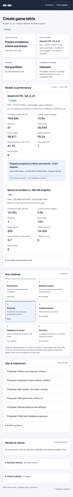

# so-so

**Software on software.** Write what you want in `INTENT.md`, then run:

```sh
./so-so
```

Or give it the assignment directly:

```sh
./so-so "Build a browser platform game"
```

The launcher prepares its runtime, reads your intent, finds configured models and
works in a managed copy of your project. Running it again resumes matching
unfinished work. You do not need to create a virtual environment or initialize Git.

so-so is MIT-licensed. After checkout, it runs from local files without GitHub
access. It uses the inference services and tools available for your assignment;
installing missing tools may require network access and installation permission.

**This checkout includes an explicit model policy in `soso.json`.** Adapt its
endpoints, model names and dashboard address to your machines, or set
`use_project_model_policy` to `false` to use discovery and the Markdown preferences
below. See [the included model policy](docs/routing.md#included-deployment-policy).

The [Tetris example](examples/tetris/INTENT.md) contains only `Create game tetris`:

```sh
./so-so --intent ./examples/tetris/INTENT.md
```

The runner chooses reasonable implementation defaults from the assignment and
available tools. With `--intent`, the file's directory supplies the starting files;
work happens in an isolated copy. The intent can also refer to existing code,
datasheets or other resources by path, in ordinary language.

The [security review example](examples/security-review/INTENT.md) asks for fixes
to an older web application linked by URL:

```sh
./so-so --intent ./examples/security-review/INTENT.md
```

If interrupted, continue the latest task with:

```sh
./so-so resume
```

This uses its saved assignment and workspace, even if the original files changed.
To select an older task, use `./so-so resume TASK_ID`; the exit message prints its ID.

## Describe the outcome

Include the outcome, available resources and routing preferences in `INTENT.md`:

```markdown
# Inventory application

Build a small inventory website. Users can add products, change stock counts,
search, and export CSV. Store data locally and include automated tests.

## Available resources

Ollama on http://my-server:11434 has my Qwen model and a smaller classifier model.
Kimi is available through the installed command-line tool.

## Routing preferences

Use the small model to classify jobs.
Routine code generation goes to local Qwen because it has no provider charge.
Difficult debugging and final review go to Kimi.
For a job that does not match a rule, use Kimi.
Wait when providers exhaust their quota and resume when capacity returns.
```

Use your actual endpoints and model names. You can specify multiple models,
command adapters, matching rules, exclusions, specialists and a default route.
so-so translates these preferences into a validated policy and saves it with the
goal. Models receive work only through eligible routes, within their context and
availability limits.

Initial Markdown policy setup needs a discoverable Ollama service or an installed
Codex, Claude or Kimi CLI. A custom API or command alone cannot yet bootstrap it.
An explicit project model policy overrides Markdown model preferences.

## Watch the work

`./so-so` prints a dashboard URL. The dashboard shows the roadmap, current activity,
model identities and hosts, elapsed times, measured usage, checks and visual
outputs. The planner can add metrics relevant to your intent. Percentages, token
counts and ETAs appear only when supported by recorded data.

See [dashboard details](docs/dashboard.md) for remote access and attaching to an
existing run. The terminal prints the result and evidence locations when work stops.

<details>
<summary>Screenshot: a live Tetris run</summary>

The run is preparing acceptance checks. The dashboard shows the active local model,
CPU architect, elapsed call times, token counts, throughput and proposed milestones.



</details>

## How it works

so-so sends bounded context to models, executes their requested actions and returns
observations. The host handles files, Git, builds, tests and commands; a model does
not need filesystem or GitHub access.

With separate architect and coordinator routes, the architect produces a compact
strategy once. The faster coordinator assigns implementation steps to workers and
uses test results to choose what happens next. The strategy survives restarts; a
specific contradiction in evaluated results can trigger one revision.

The loop implements small steps, runs checks and reviews results. Experiments can
run in parallel isolated worktrees; delivery integrates reviewed steps in order.
Completion requires acceptance evidence and a separate review. A plateau means
completed attempts stopped improving; malformed responses and failed executions
are reported as failures, not progress toward a plateau. Invalid model responses
receive bounded repair attempts. Temporary provider failures wait and retry.

State and managed results live under `.so-so/`. Open `.so-so/README.md` for an
intent history with status and links. Snapshot folders use an intent title and a
short revision fingerprint; each contains the exact assignment in `INTENT.md`
and a `README.md` with result and evidence paths. A changed intent or changed
source creates a separate snapshot. Copy wanted results before deleting this
directory: it contains the work itself as well as resume checkpoints. Source snapshots exclude common
credential files; keep credentials in the host's credential stores rather than
intent text.

Selected [Superpowers](https://github.com/obra/superpowers) planning, debugging,
testing and review skills are pinned and bundled with their license.

## Validation and operating limits

The [validation record](docs/validation.md) contains automated checks, live project
trials, rejected candidates and measured self-improvement. These results cover the
recorded setups, not every possible assignment.

The runtime uses Python's standard library. Bootstrap can provision Python locally
and install Git through supported Linux package managers when permitted. The
bundled self-improvement assignment can also prepare Node and C build tools for
its checks. Models are not downloaded automatically.

Commands run with host permissions. Git worktrees isolate source changes, but do
not sandbox commands or undo cloud operations. Acceptance checks and model reviews
can miss requirements; inspect the results before relying on them.

Further reference: [routing](docs/routing.md),
[configuration](docs/configuration.md), [operations](docs/operations.md),
[Superpowers provenance](docs/superpowers.md).
